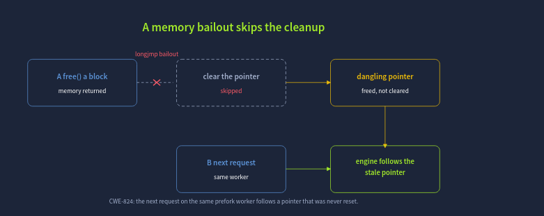
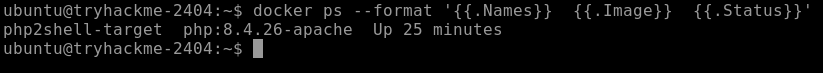
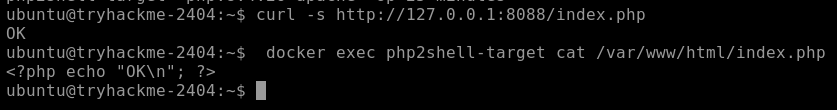
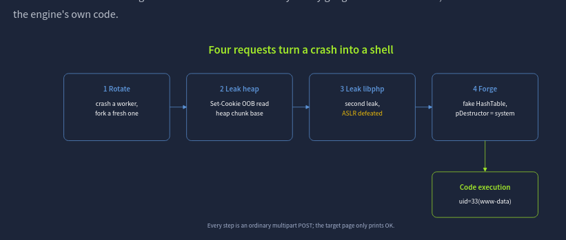
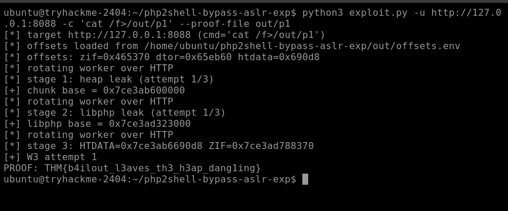
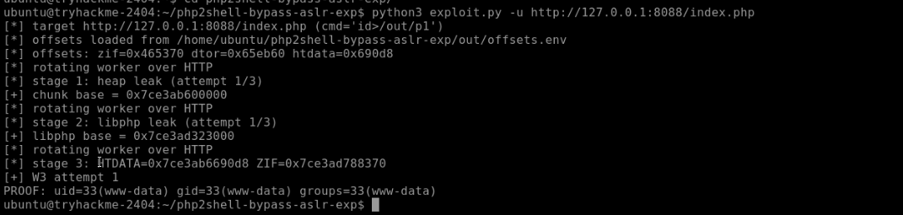

# PHP2Shell — CVE-2026-109618 / CVE-2026-109619

> A report on the PHP runtime double-vulnerability disclosed on **21 October 2026**, with a working demo against a vulnerable `php:8.4.26-apache` container.


---

## Table of contents

1. [Overview](#overview)
2. [The CVEs](#the-cves)
3. [The feature being abused](#the-feature-being-abused)
4. [The bug — a bailout that skips cleanup](#the-bug--a-bailout-that-skips-cleanup)
5. [Why it isn't harmless](#why-it-isnt-harmless)
6. [Reconnaissance](#reconnaissance)
7. [The exploit chain](#the-exploit-chain)
8. [Demo](#demo)
9. [Mitigation](#mitigation)
10. [Detection](#detection)
11. [References](#references)

---

## Overview

PHP2Shell is the name given to a pair of PHP runtime vulnerabilities that allow **unauthenticated remote code execution** against almost any PHP server over ordinary HTTP. No login, no file upload bug, no application mistake is required. The flaw lives in the PHP engine itself and affects every version from **PHP 5.4.0 (2012)** up to the patched releases.

Details leaked a day before coordinated disclosure, and exploitation in the wild was observed within hours.

## The CVEs

| CVE | Impact | CVSS v4.0 |
|-----|--------|-----------|
| **CVE-2026-109618** | Out-of-bounds memory disclosure | 9.2 Critical |
| **CVE-2026-109619** | Remote code execution | 9.2 Critical |

- Discovered by researchers at **Wiz**, **OpenAI** and **Calif**.
- Patched in **PHP 8.5.12**, **8.4.27**, **8.3.36** and **8.2.35**.
- Root-cause class: **CWE-824** (Access of Uninitialized Pointer).

## The feature being abused

When you upload a big file through a web form, the browser needs some way to show a progress bar. PHP has a default progress tracker called `session.upload_progress`. While the file is being uploaded PHP takes down information about the file (name, size, how many bytes have arrived) and stores it in your session. A second page can then peek at the session and tell the browser "you're 40 percent finished".

The exploit comes into play because of **when** PHP does this bookkeeping. PHP writes those progress details while it is still reading the raw upload off the network, **before** it even looks at the script you asked for or runs any of the website's own code.

Because the progress tracking runs before the application starts, there is no login needed, no special upload page required, and the target script does not have to call `session_start()`. Any URL that accepts a POST request is enough, even one that just prints "hello".

To switch the feature on, the attacker only has to include a form field named `PHP_SESSION_UPLOAD_PROGRESS` in their upload. The entire PHP2Shell attack happens inside this tiny window, while the actual website hasn't even started running yet.

> **Q.** What is the default name of the form field that switches on PHP's upload-progress tracking?
> **A.** `PHP_SESSION_UPLOAD_PROGRESS`

## The bug — a bailout that skips cleanup

PHP has a rule: each request can only use so much memory. If a request tries to use more, PHP has to abort. It cannot finish the job and it cannot clean up normally, so it does an emergency jump straight back to a safe point in the code. The engine calls this a **bailout**, implemented in C with `longjmp()`.

It is a bit like a fire drill. When the alarm goes off you don't go and do other things, you exit to the nearest door. A bailout is PHP exiting.

### The actual bug

When PHP finishes with a chunk of memory it normally does two things:

1. **Frees the memory** (gives it back).
2. **Clears the pointer** (the note telling it where the memory was).

The bug is a **timing problem**. If PHP runs out of memory **in between** step 1 and step 2, after freeing the memory but before clearing the pointer, the bailout kicks in and skips the cleanup. The pointer is left behind, still pointing at memory that no longer belongs to anything.

This abandoned sticky note is called a **dangling pointer** and it falls under **CWE-824**.



## Why it isn't harmless

Normally a crashed request takes its mess with it to the grave. The process ends, memory gone. But with Apache's `mod_php` it doesn't work that way. One worker handles request after request after request, and it is never restarting.

So the pointer sticks around in the worker's memory. The next request to land on that same worker finds PHP holding that stale note and reaching for whatever is at that address, except now the attacker can arrange for **their data** to be sitting there.

From that single flaw researchers built two exploits:

- **CVE-2026-109618** reads back memory at the stale pointer as a string of attacker-chosen length and returns it in an HTTP response header. That's a window into the server's memory.
- **CVE-2026-109619** turns the corrupted state into control over what code the program runs: a shell.

> **Q.** What one-word name does the PHP engine give to the `longjmp` it performs to abort a request that hits a fatal error such as running out of memory?
> **A.** `bailout`
>
> **Q.** What is the CWE identifier for the weakness class behind PHP2Shell?
> **A.** `CWE-824`

## Reconnaissance

The target is a vulnerable server running in a Docker container listening on `localhost:8088`.

### Step 1 — identify the server



The server is running **8.4.26**, one short of the **8.4.27** fix, so it is vulnerable.

### Step 2 — probe the endpoint



The target script does nothing but `echo "OK\n";`. That is all it takes. The bug fires before this script ever runs.

## The exploit chain

Most modern computers protect themselves by placing programs in random spots in memory each time they run. This is called **ASLR** (Address Space Layout Randomisation), almost like hiding things in a different drawer so a thief can't find them. An attacker needs to know where things are in memory, and ASLR stops them from knowing. **This bug breaks that protection.**

The attacker makes PHP run out of memory on purpose while it is handling a session ID. That leaves a broken pointer pointing at old memory. The attacker then tricks PHP into thinking that memory is much bigger than it really is. When PHP sends the session cookie back to the user, it reads **way** too much data and sends it all back in the response.

The result is that the attacker gets about **67 KB of the server's private memory with every request**. In the real world that could contain passwords, login cookies, API keys and secret encryption keys.

The attacker does this leak twice:

1. First leak — find where the PHP memory heap starts.
2. Second leak — find where PHP's main code library (`libphp`) starts.

Each run of the exploit shows two `[+]` lines holding those two addresses. They look different every time because ASLR is still shuffling them, but the attack just reads them fresh each time instead of guessing.

### From leak to shell

The leak tells the attacker where everything is. CVE-2026-109619 turns that into a command running on the server by **re-occupying the freed memory**, not with data to read but with a carefully forged object that hijacks into the engine's own cleanup machinery.

**Breakdown**

- **PHP's cleanup crew.** When PHP finishes its work it cleans up data by calling a built-in function called a **destructor** to delete temporary files.
- **The hijacking.** The exploit slips a fake piece of data into the computer's memory right where PHP expects to find its safe cleanup instructions.
- **Pointer swap.** Instead of pointing to a normal harmless cleanup function, the exploit changes the pointer so it points to `system()`, which can be used to run commands on the operating system.
- **Executing the command.** When PHP tries to do its routine cleanup it accidentally runs the attacker's hidden command. The result is instead of cleaning up, PHP gives the attacker full remote access.



| # | Request | What it does |
|---|---------|--------------|
| 1 | **Rotate** | Crash a worker, fork a fresh one |
| 2 | **Leak heap** | `Set-Cookie` out-of-bounds read — heap chunk base |
| 3 | **Leak libphp** | Second leak — ASLR defeated |
| 4 | **Forge** | Fake `HashTable`, `pDestructor = system` |

Every step is an ordinary multipart POST; the target page only prints `OK`.

## Demo

To find our flag we just have to issue our command to read it.

```bash
python3 exploit.py -u http://127.0.0.1:8088 \
    -c 'cat /f>/out/p1' \
    --proof-file out/p1
```



```
PROOF: THM{b4ilout_l3aves_th3_h3ap_dang1ing}
```

Running it with `id` instead confirms code execution as the Apache user:

```bash
python3 exploit.py -u http://127.0.0.1:8088/index.php
```



```
PROOF: uid=33(www-data) gid=33(www-data) groups=33(www-data)
```

## Mitigation

- **Updating the browser does not fix it. You have to update PHP** to **8.4.27** or **8.5.12** (or the patched 8.3.x / 8.2.x release).
- **Temporary workaround.** If you can't upgrade PHP immediately, turn off the vulnerable feature by setting:

  ```ini
  session.upload_progress.enabled = 0
  ```

- Standard security firewalls that run **inside** PHP won't catch it, because the attack exploits code **before** the website's own code even starts running.

## Detection

Look for signs in your server logs such as:

- Weirdly long session IDs (`PHPSESSID`).
- Giant upload requests.
- PHP crashing unexpectedly or workers being recycled abnormally.

## References

- CVE-2026-109618 — PHP session.upload_progress out-of-bounds read
- CVE-2026-109619 — PHP session.upload_progress use-after-free RCE
- CWE-824 — Access of Uninitialized Pointer
- PHP release notes: 8.5.12, 8.4.27, 8.3.36, 8.2.35
- TryHackMe room: **PHP2Shell**

---

*Report compiled by Jithin Jelson — walkthrough of the TryHackMe PHP2Shell room, written up as a vulnerability report.*
